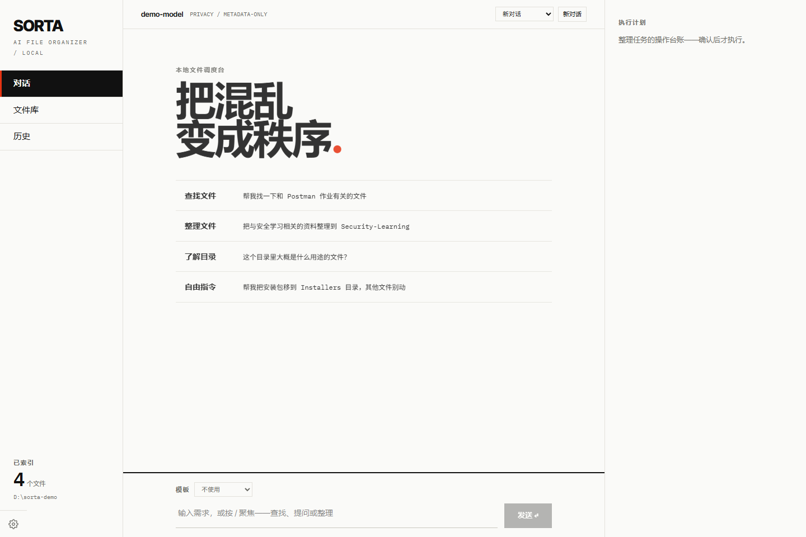
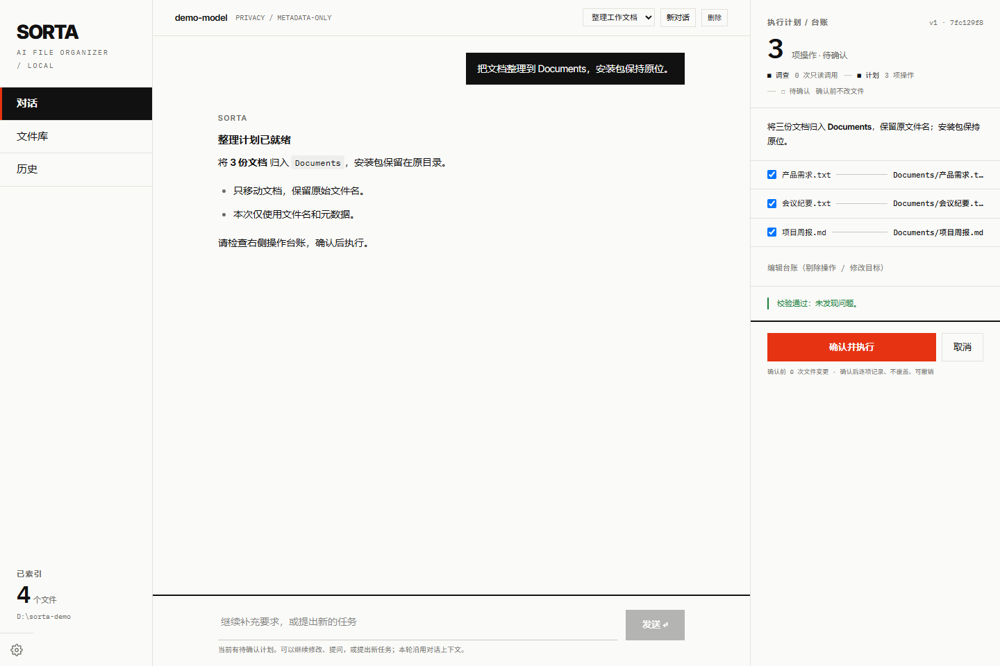

<div align="center">

# SORTA

**用自然语言整理文件，让每一次变更都看得见、可确认、可撤销。**

本地优先的 AI 文件整理助手 · 对话式操作 · 计划预览 · 执行记录


[界面预览](#界面预览) · [快速开始](#快速开始) · [使用方式](#使用方式) · [开发与测试](#开发与测试)

</div>

## 项目介绍

SORTA 将文件查找、目录问答和整理操作放进同一个本地 Web 界面。用一句话描述需求，先查看整理计划，再决定执行；后续可以继续调整计划，或在历史记录中撤销操作。

- **自然语言交互**：查找文件、了解目录、按用途整理资料，也可以追加约束和修订计划。
- **操作前预览**：展示源路径、目标路径、操作原因与置信度，支持逐项调整。
- **移动、复制与空目录清理**：空目录按先子后父的顺序清理，执行时再次检查。
- **持续对话**：对话、关联计划与执行结果持久化保存，刷新后可以继续。
- **历史与撤销**：记录每项操作的结果，满足恢复条件时可撤销整个批次。
- **可配置模型**：支持兼容 OpenAI 接口的模型服务，提供连接测试和整理模板。

## 界面预览

### 对话首页

选择工作目录后，可以查找文件、了解目录，或直接描述整理需求。



### 整理计划

对话与操作台账并排展示。检查每项变更，再点击「确认并执行」。



> 截图来自本地运行的项目，使用演示文件与预置计划，不包含真实用户文件或密钥。

## 快速开始

### 环境要求

| 工具 | 要求 |
| --- | --- |
| 操作系统 | 优先支持 Windows 10 / 11；macOS、Linux 尚未完整验证 |
| Python | 3.12 或以上 |
| Python 包管理器 | [uv](https://docs.astral.sh/uv/getting-started/installation/) |
| Node.js | 建议 22.12 或以上，仅前端开发和构建时需要 |

### 安装与启动

在 PowerShell 中运行：

```powershell
git clone https://github.com/camlloo/sorta.git
cd sorta

uv sync --locked

cd frontend
npm ci
npm run build
cd ..

uv run sorta ui
```

浏览器会自动打开 [http://127.0.0.1:8502](http://127.0.0.1:8502)。后续启动只需要在仓库根目录运行 `uv run sorta ui`。

如果端口被占用，可以指定其他端口：

```powershell
uv run sorta ui --port 8503 --no-browser
```

### 配置模型与工作目录

1. 打开「设置」，填写模型名称、Base URL 和 API Key；模型需支持工具调用才能生成整理计划。
2. 点击「测试连接」，确认对话和工具调用均可用。
3. 填写允许整理的工作目录，选择隐私模式，再点击「保存并扫描」。
4. 返回「对话」，输入需求并检查右侧计划，确认后执行。

也可以复制 [`.env.example`](.env.example) 为 `.env`，通过环境变量配置模型及扫描限制：

```powershell
Copy-Item .env.example .env
```

设置页的配置保存在本机 `ui_settings.json`。`.env`、本地设置和数据库均已加入 Git 忽略规则。

## 使用方式

可以从这些指令开始：

```text
帮我找一下和 Postman 作业有关的文件
这个目录里大概是什么用途的文件？
把学习资料按主题整理，安装包保持原位
把目标目录改为 Learning，其他要求不变
把目录下的所有空文件夹删除
```

「文件库」用于浏览扫描结果，「历史」用于查看执行详情和撤销批次，「设置」用于管理模型、目录授权、隐私模式与整理模板。

### 命令行

```powershell
# 只读扫描，不需要模型 API Key
uv run sorta scan "D:\Downloads"

# 生成计划，再校验与确认执行
uv run sorta plan --root "D:\Downloads" --request "把文档归入 Documents" --output plan.json
uv run sorta inspect-plan plan.json
uv run sorta apply plan.json

# 查看执行批次，再按批次 ID 撤销
uv run sorta history
uv run sorta undo "EXECUTION_ID"
```

将 `EXECUTION_ID` 替换为历史记录中的实际批次 ID。

## 安全与数据

- **先审批后变更**：计划编辑后原审批失效，执行前会重新校验版本、路径和文件状态。
- **不静默覆盖**：目标文件已存在时拒绝覆盖；操作范围限制在授权目录内。
- **空目录保护**：只使用 `rmdir` 删除空目录；保护授权根目录、隐藏目录及符号链接，目录变为非空时拒绝删除。
- **条件式撤销**：撤销会检查当前文件状态和路径冲突，属于尽力恢复，不是事务性回滚；暂不支持跨盘移动。
- **隐私可选**：支持仅元数据、读取正文前询问、已授权读取正文三种模式。本地保存记录，调用模型时仍会向所配置的服务发送相应元数据或获准读取的内容。
- **本机服务**：默认仅监听 `127.0.0.1`，API 使用本机会话凭据鉴权。

示例 `.env` 将数据库设为仓库根目录的 `sorta.db`；不设置 `SORTA_DB_URL` 时，Windows 默认使用 `%APPDATA%/sorta/sorta.db`。设置文件与数据库位于同一目录。扫描快照默认有效期为一小时，过期计划需要重新扫描并生成。

## 项目结构

```text
sorta/                       # 仓库根目录
├── README.md
├── pyproject.toml            # Python 项目配置与 CLI 入口
├── uv.lock
├── .env.example
├── docs/images/              # README 界面截图
├── frontend/                 # React + TypeScript + Vite + Tailwind CSS
│   └── src/
├── sorta/                    # Python 源码包
│   ├── agent/                # 模型调用、提示词与只读工具
│   ├── api/                  # FastAPI 路由、鉴权与静态托管
│   ├── application/          # 业务编排与后台任务
│   ├── scanner/              # 文件扫描、目录发现与受控读取
│   ├── planner/              # 计划校验、编辑与冲突检查
│   ├── executor/             # 文件操作、日志与撤销
│   ├── storage/              # SQLite 持久化与数据库迁移
│   └── cli.py
└── tests/                    # 回归测试
```

仓库根目录可以直接执行 `uv` 命令。内部的 `sorta/` 是 Python 包，导入路径为 `sorta.*`。

## 开发与测试

在仓库根目录运行后端检查：

```powershell
uv run pytest -q
uv run ruff check .
```

在 `frontend/` 目录运行前端检查和构建：

```powershell
cd frontend
npm run lint
npm run build
```

前端热更新开发：先在仓库根目录运行 `uv run sorta ui --no-browser`，再在另一个终端进入 `frontend/`，运行 `npm run dev`。Vite 将 `/api` 请求代理到 `http://127.0.0.1:8502`，详细说明见 [前端开发指南](frontend/README.md)。

回归测试使用临时目录、独立数据库和模型替身，不需要真实 API Key。覆盖计划审批、路径边界、移动与复制、空目录清理、撤销、多轮上下文和数据库迁移等流程。

## 反馈与贡献

欢迎通过 [GitHub Issues](https://github.com/camlloo/sorta/issues) 反馈问题或建议。提交问题时请附上复现步骤、预期结果、实际结果和运行环境；提交代码前请运行上述检查。
