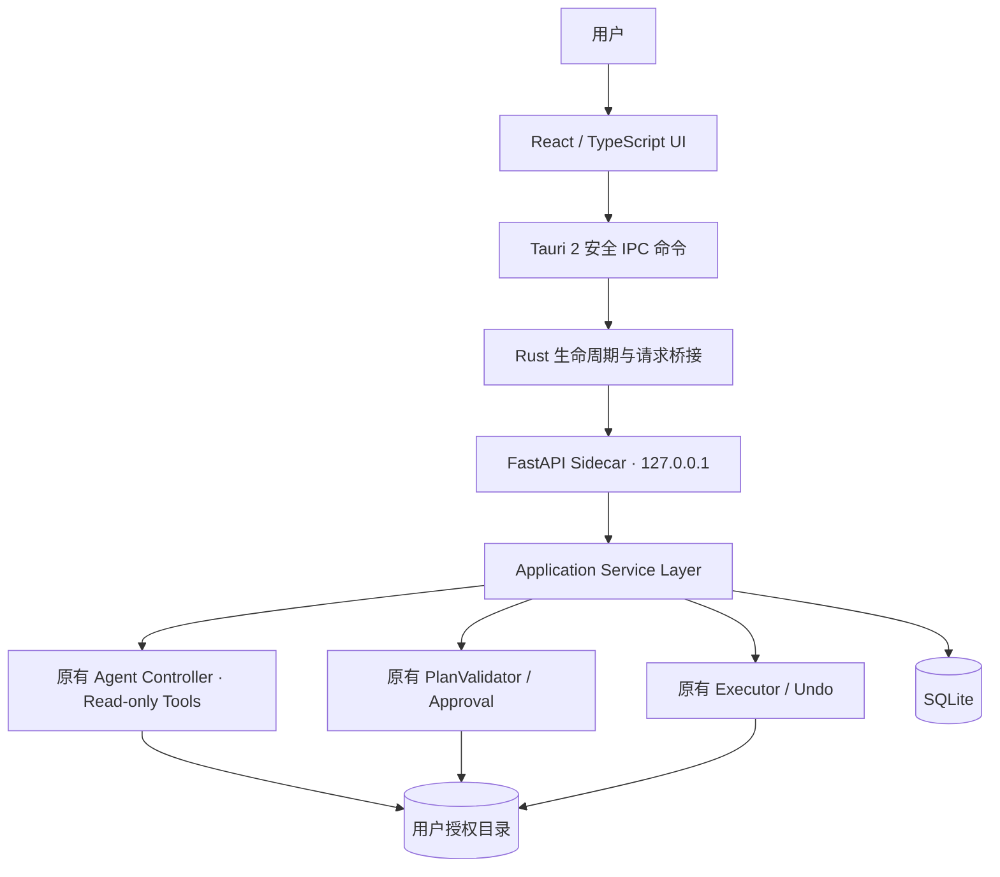

# SORTA — 桌面版架构升级与实施开发文档

> **文档版本**：v2.0（架构升级实施规格草案）  
> **编写日期**：2026-10-25  
> **文档定位**：原《SORTA — AI 智能文件整理 Agent 开发文档 v1.0》的**增量配套文档**，不是替代文件  
> **核心方向**：现有 Python Agent 保持不变；新增 FastAPI 服务层、React 前端与 Tauri 2 桌面壳  
> **目标平台**：Windows 10/11 x64 优先；macOS、Linux 后续适配  
> **开发理念**：Local-first / 最小授权 / 先计划后执行 / 可审计 / 有条件撤销 / 不引入 Agent 框架

---

## 0. 阅读说明与项目基线

### 0.1 资料来源与真实性边界

本文以用户提供的《SORTA_开发文档(1).md》为主要项目资料。其第 14 章记录 M1—M5 已于 2026-10-24 完成，包括 Scanner、Registry、Readers、手写 Tool Calling 循环、PlanValidator、SQLAlchemy + SQLite、Executor、Undo 和 Streamlit UI；第 11 章记载 `uv run sorta ui` 可启动图形界面，CLI 命令也已实现。文档还报告了一次基于 56 个文件的评估结果。

**上述完成情况是原文档中的项目记录，本次没有访问或运行实际项目源码，因此不将这些记录表述为已经独立复验。** 原文档第 16 章的 Definition of Done 尚未勾选，第 18 章仍写着“先完成 M1”，属于文档不同阶段留下的历史内容。建议在迁移之前以仓库代码、测试结果和实际运行情况为准完成基线核查，不依赖文字记录推断当前软件状态。

### 0.2 已确定且不应推翻的设计

- 使用 Python 3.12+、uv、Pydantic、SQLAlchemy 2.x 与 SQLite；Agent 使用 OpenAI-compatible API 和**自己实现的原生 Tool Calling 循环**。
- LLM 只能调用 `list_files`、`get_file_info`、`read_file`、`search_files` 等只读工具，**不能直接调用文件移动、复制、删除、Shell**。
- 所有操作必须按照 `ExecutionPlan → Validation → 用户审批 → Executor` 执行。
- `plan_hash` 与审批版本严格绑定，文件发生变化必须重新检查，不静默覆盖，操作日志支持条件式 Undo。
- 文档解析内容为不可信输入；模型输出无权突破文件授权范围。
- 保留 CLI，保留现有 Streamlit UI 作为迁移期可用版本/回归测试入口；桌面 UI 不是理由去重写核心业务。

### 0.3 本次变更范围

**本次新增**：独立 API 服务、前端应用、桌面运行容器、跨进程通信、Sidecar 打包、桌面生命周期管理、UI 规范、打包与安装验收。

**本次不做**：重写 Tool Calling、换 LangGraph、向量数据库、云端账号、自动后台全盘扫描、自动删除文件、网络同步、移动端、自动授权任意文件目录。

---

## 1. 产品形态及关键技术决策

### 1.1 结论

SORTA 的**正式产品形态是本地桌面应用**。日常使用应体现为单一安装包、独立窗口、原生目录选择、直观的操作预览、真实的执行结果与撤销入口；用户无需安装 Python、Node.js、uv，也无需手动运行服务。

开发过程分两层验证：

1. **本地 Web 阶段**：React（Vite）与 FastAPI 分别启动，快速打通 API、业务和 UI。
2. **桌面封装阶段**：Tauri 2 启动并管理预打包的 Python Sidecar，加载 React 构建产物，并通过安全桥接访问 FastAPI。

### 1.2 最终选型

| 层 | 选型 | 职责 | 说明 |
|---|---|---|---|
| Desktop Shell | Tauri 2（Rust） | 创建窗口、调用原生目录选择、启动 Sidecar、生命周期管理 | 只授予必要 Capability |
| Frontend | React + TypeScript + Vite | 三栏交互、计划预览、执行状态、设置和历史 | 保留瑞士风布局 |
| UI Styling | Tailwind CSS（可选 shadcn/ui 原语） | 设计 Token、响应式布局、基础组件 | 不引入庞大管理后台模板 |
| Service API | FastAPI + Uvicorn | 统一业务 API、请求验证、任务执行状态 | 本机进程内，非公网 SaaS |
| Agent | 原有 `sorta/agent/` | 原生 Tool Calling 与计划生成 | 原模块复用 |
| File Engine | 原有 scanner/planner/executor | 文件发现、校验、审批、移动与 Undo | 唯一真实文件写入权威 |
| Persistence | SQLite + SQLAlchemy 2.x | 文件注册、计划、审批、执行日志与设置 | 不新增云数据库 |
| Packaging | PyInstaller（Python）+ Tauri Bundler | 形成 Sidecar 和桌面安装包 | 每个平台单独构建 |
| QA | pytest + API tests + 前端测试 + 桌面冒烟测试 | 确认业务未回退且桌面安全边界有效 | 复用原有测试集 |

### 1.3 为什么不是直接把 Streamlit 塞进桌面窗口

此方式可以快速试验，但会保留 Streamlit 的会话/重运行模型和 UI 定制限制。既然已经确定极简瑞士风三栏工作台，推荐独立 React 页面；**迁移只发生在表示层与服务层**，Agent、数据库和 Executor 不变。

---

## 2. 目标架构



**重点：**

- **唯一业务真相在 Python**。不能在 TypeScript 再写一套 PlanValidator 或 Undo 逻辑。
- React 负责展示与用户意图输入，Rust 负责桌面能力/进程，FastAPI 负责权限边界内的业务服务。
- Tauri 的原生选择器负责让用户挑选目录，但 Python **仍需自己验证**工作根目录以及每个文件读写范围。
- 前端可以展示完整路径用于人工识别；Agent 本身只能通过 `file_id` 访问已发现的文件。

### 2.1 开发阶段与生产阶段的通信区别

**开发环境**：`React localhost → FastAPI 127.0.0.1:<dev-port>`，允许固定且精确的本地开发来源（例如实际使用的 Vite Origin），明确标识这是开发配置。

**安装版**：`React → Tauri invoke(受限命令) → Rust → 本地 FastAPI Sidecar`。Rust 保存当前 Sidecar 的实际端口和临时鉴权凭据，避免在浏览器 JavaScript 中长期暴露后台控制凭据。推荐提供多个**业务白名单命令**，而不是一个允许任意 URL / 路径的通用 HTTP 代理。

不允许把 FastAPI 监听到 `0.0.0.0`。仅绑定 `127.0.0.1` 也不等于安全：需要随机会话凭据、Host 限制、严格 CORS（开发模式）、请求体限制以及对写操作的独立审批校验，防止本地其他进程或恶意网页滥用 API。

---

## 3. 迁移策略：保留核心，提取服务层

### 3.1 迁移原则

已有 Streamlit 代码可能直接调用 scanner、controller、executor 等对象。**不要把原有 `ui/app.py` 改成新的业务入口**；应将业务操作整理为 `Application Service`，让 CLI、Streamlit、FastAPI 都调用它。

建议提供以下服务接口：

```python
class SortaService:
    def create_workspace(self, root: str, authorization_context): ...
    def start_scan(self, workspace_id: str, options): ...
    def generate_plan(self, scan_id: str, request: str, privacy): ...
    def validate_plan(self, plan_id: str): ...
    def edit_plan(self, plan_id: str, changes, expected_version: int): ...
    def approve_plan(self, plan_id: str, plan_hash: str, user_confirmation): ...
    def execute_approved_plan(self, approval_id: str, request_id: str): ...
    def list_executions(self, limit: int): ...
    def undo_execution(self, execution_id: str, request_id: str): ...
```

> 这是**建议的业务接口草案**，不是已存在的源码签名。命名可以按仓库实际情况调整，但审批、执行以及 Undo 不应绕过现有领域规则。

### 3.2 旧与新的模块映射

| v1.0 已有模块 | 是否保留 | v2.0 新增适配 |
|---|---|---|
| `agent/controller.py` | 完整保留 | 将执行事件映射为 UI 可读状态 |
| `agent/tools.py` | 完整保留 | 不扩大工具白名单 |
| `scanner/*` | 完整保留 | 增加分页/延迟加载适配（必要时） |
| `planner/*` | 完整保留 | API 暴露校验结果和计划版本 |
| `executor/*` | 完整保留 | API 提供执行状态/冲突/撤销入口 |
| `storage/*` | 迁移复用 | 增加数据库连接生命周期管理 |
| `cli.py` | 保留 | 改为调用统一服务层（若尚未如此） |
| `ui/app.py` (Streamlit) | 保留 | 新增独立 React 前端，不就地覆盖 |
| 无 | 新增 | `sorta/application/`、`sorta/api/`、`desktop/` |

### 3.3 数据库迁移约束

原文档已有 `scan_sessions`、`file_registry`、`plans`、`approvals`、`executions`、`operation_logs` 六类表。桌面版不应仅因换 UI 而重新建库、清空数据或把 SQLite 放在安装目录。

- 数据目录归属于**当前 OS 用户**，不与桌面安装文件混放；Windows 可考虑 `%APPDATA%/SORTA/`，Mac 采用应用支持目录（由桌面 API 决定）。
- 迁移前备份现有数据库；涉及结构变更使用有版本号的迁移机制（如 Alembic）或经过测试的显式迁移脚本。
- 不强行自动迁移旧测试数据库或相对路径 `sorta.db`；区分开发数据库与用户真实数据库。
- 保持原日志、`plan_hash`、审批与执行关系不变，必须可查旧历史与正常 Undo。

---

## 4. FastAPI API 设计（v1）

API 响应建议统一：成功时直接返回资源对象，失败时返回 `code`、`message`、`details`、`request_id`。所有写请求必须通过 Pydantic 校验，并有结构化错误码。

### 4.1 路由清单

| Method | Endpoint | 用途 | 核心约束 |
|---|---|---|---|
| GET | `/api/v1/health` | Sidecar 健康状态 | 不暴露密钥或敏感路径 |
| POST | `/api/v1/workspaces` | 注册用户授权目录 | 必须携带桌面端授权证明，不能仅信任字符串路径 |
| GET | `/api/v1/workspaces/{id}` | 展示目录和最近扫描 | 仅可访问当前会话授权的目录 |
| POST | `/api/v1/scans` | 启动目录扫描 | 深度、文件数等上限 |
| GET | `/api/v1/scans/{id}` | 获取扫描进展及文件列表 | 分页，不能把完整大目录一次塞入 UI |
| POST | `/api/v1/plans` | 启动 Agent 规划 | `scan_id`、请求、隐私策略，返回 job/plan id |
| GET | `/api/v1/plans/{id}` | 获取完整结构化计划 | 返回依据、风险、版本与冲突 |
| PATCH | `/api/v1/plans/{id}` | 人工编辑计划 | 版本匹配，编辑后使旧审批失效 |
| POST | `/api/v1/plans/{id}/validate` | Dry Run 验证 | 不修改文件系统 |
| POST | `/api/v1/plans/{id}/approve` | 绑定用户批准的 `plan_hash` | 明确用户意图、版本不可变 |
| POST | `/api/v1/executions` | 执行已经批准的计划 | `approval_id` + 幂等请求 ID + 执行前复验 |
| GET | `/api/v1/executions/{id}` | 查看批次/逐项结果 | 保留冲突与失败原因 |
| POST | `/api/v1/executions/{id}/undo` | 尝试安全撤销 | 逐项比对指纹，不覆盖变化后的文件 |
| GET | `/api/v1/history` | 查看历史 | 默认分页、敏感字段过滤 |
| GET / PUT | `/api/v1/settings` | 读写本地设置 | 密钥由安全存储或后端处理，不返回明文 |

### 4.2 核心数据传输模型

```json
{
  "plan_id": "plan_001",
  "scan_id": "scan_001",
  "version": 3,
  "plan_hash": "sha256:<hex>",
  "status": "awaiting_approval",
  "summary": "按学习主题分类",
  "operations": [
    {
      "source_id": "file_001",
      "destination": "Security/Web/SQLi-notes.pdf",
      "action": "move",
      "confidence": "high",
      "reason": "文件内容包含 SQL 注入学习笔记"
    }
  ],
  "issues": []
}
```

响应中的 `plan_hash` 由后端计算，**不接受客户端自报的 hash 作为校验事实**。客户端点击批准时，后端应确认请求的版本/哈希与当前数据库中的不可变计划一致。

### 4.3 执行流程示例

```http
POST /api/v1/plans/plan_001/validate
Authorization: Bearer <session-token>

{}
```

```http
POST /api/v1/plans/plan_001/approve
Authorization: Bearer <session-token>

{"expected_version":3,"expected_plan_hash":"sha256:<hex>"}
```

```http
POST /api/v1/executions
Authorization: Bearer <session-token>
Idempotency-Key: <unique-request-id>

{"approval_id":"approval_001"}
```

以上仅是协议示例；安装版推荐通过 Tauri IPC 包装，而不是让前端直接管理这个 Token。

### 4.4 长耗时任务与进度

`POST /scans`、`POST /plans` 不要让 UI 无限等待 HTTP 请求。返回 `job_id`，UI 短时间轮询 `GET /jobs/{id}` 即可。第一版优先轮询（约 0.5–2 秒），不必立刻引入 WebSocket、Celery 或 Redis。

建议统一 Job 状态：`queued → running → completed / failed / canceled`。取消必须显式定义为“停止接下来的工作”，已生效文件操作不得伪装成回滚；执行阶段的安全停点以每个文件操作为单位。

### 4.5 错误码建议

| 错误码 | 解释 | 前端反馈 |
|---|---|---|
| `WORKSPACE_NOT_AUTHORIZED` | 尚未选择或无权访问目录 | 提示重新选择 |
| `SCAN_EXPIRED` | 文件注册会话过期 | 重新扫描 |
| `FILE_CHANGED` | 源文件扫描后被修改 | 停止操作并重新验证 |
| `PLAN_STALE` | 计划版本改变 | 返回编辑页面重新确认 |
| `PLAN_CONFLICT` | 目标路径冲突 | 标红受影响操作 |
| `APPROVAL_REQUIRED` | 未获得有效批准 | 阻止执行 |
| `EXECUTION_IN_PROGRESS` | 同一计划正在执行 | 禁止重复提交 |
| `UNDO_CONFLICT` | 撤销目标发生变化 | 保留文件、提示人工处理 |
| `MODEL_UNAVAILABLE` | 模型接口不可用 | 保持本地文件未变 |

---

## 5. Swiss Style 桌面 UI 规范

### 5.1 布局延续既有概念稿

保留前面确定的「**左导航 + 中央自然语言工作区 + 右执行计划预览**」三栏，进一步减少视觉噪音。无彩色大面积卡片、无密集数据表格、无持续弹出的 AI 气泡。

```text
┌────────────────┬──────────────────────────────────┬───────────────────┐
│ SORTA          │ 对话 / 工作台                    │ 计划预览          │
│                │                                  │                   │
│ 对话           │         你好，我是 SORTA          │ 01 发现文件       │
│ 文件库         │    用自然语言管理你的本地文件      │ 02 分类计划       │
│ 设置           │                                  │ 03 审批执行       │
│                │  查找文件     整理文件            │                   │
│                │  总结内容     其他操作            │ 影响文件列表      │
│                │                                  │ 冲突/不确定项     │
│ 目录/扫描状态  │  [ 输入你的需求……       → ]      │ [确认] [取消]     │
└────────────────┴──────────────────────────────────┴───────────────────┘
```

### 5.2 建议尺寸与视觉规范

| Token | 建议值 | 原则 |
|---|---|---|
| Desktop 最小工作宽度 | 约 1100 px（可按产品测试调整） | 三栏不得互相挤压 |
| 左栏宽度 | 200–220 px | 只有 3 个导航项，避免二级菜单堆积 |
| 右栏宽度 | 320–360 px | 默认显示计划摘要，可展开细项 |
| 页面主色 | 黑白灰 | 优先信息层级而不是色块 |
| 强调色 | 单一中性或蓝色（少量） | 仅主操作、选中状态 |
| 网格 | 8 px 基础间距体系 | 稳定对齐、清晰秩序 |
| 字体 | Inter / system-ui / 中文系统无衬线 | 注意中英数字混排 |
| 标题 | 28–36 px，明确字重 | 强化瑞士风排版 |
| 分割线 | 1 px 浅灰 | 比阴影更适合区分信息 |
| 圆角 | 4–8 px | 减少“手机卡片式”视觉 |
| 动效 | 120–180ms | 只用于状态反馈，避免花哨 |

瑞士风的核心是**严格的网格、明确的字体层级、留白与秩序**；不等于单纯把所有颜色改成黑白。

### 5.3 页面及功能

**对话页（默认首页）**

- 顶栏：当前位置 / 隐私模式 / 模型连接状态。
- 中央空态：「你好，我是 SORTA」与四个可点击示例指令。
- 输入框：支持多行文本、提交、取消正在规划的请求。
- 调查进度：仅展示 `正在扫描 45/200 个文件`、`正在读取 2 个文件` 等摘要；展开后可查看工具调用详细记录。
- 右侧计划：待生成 / 生成中 / 待确认 / 执行中 / 已完成五种主状态；待确认时显示文件数量、操作类型、目标路径、风险与理由。

**文件库**

- 仅显示**当前授权目录的扫描结果**，不写“电脑全部文件已索引”，也不暗示一直后台索引。
- 搜索、文件信息、内容预览、已提取文本状态；无法解析时给出准确提示。
- 文件预览文本必须视为普通文本，不作为指令渲染或执行。

**设置**

- 工作目录授权与更换；隐私策略（Metadata Only / Ask Before Content / Authorized Content）。
- LLM Base URL / Model / Key 管理（Key 不回显，不出现在日志或前端持久化存储）。
- Agent 步数上限、扫描限制、取消操作、打开本地日志目录。

### 5.4 交互状态与空态

| 状态 | 中央区域 | 右侧面板 |
|---|---|---|
| `EMPTY` | 示例命令与输入框 | 简短使用说明 |
| `SCANNING` | 显示扫描进度 | 显示找到文件数量 |
| `PLANNING` | 查看 Agent 调查摘要 | 显示方案准备中 |
| `REVIEW` | 允许继续询问 | 展示可编辑执行计划与冲突 |
| `EXECUTING` | 禁止重复审批 | 展示逐项进度、失败/跳过数 |
| `COMPLETE` | 执行结果摘要 | 撤销入口与运行记录 |
| `ERROR` | 明确错误原因与重试 | 不显示误导性的“全部成功” |

对于宽度不足的窗口，右侧面板折叠为抽屉；左栏可以收窄，绝不裁切“确认执行”和“撤销”按钮。

### 5.5 组件建议

`AppShell`、`SidebarNav`、`WorkspaceHeader`、`CapabilityTile`、`AgentComposer`、`AgentActivity`、`FileList`、`PlanPanel`、`PlanOperationRow`、`RiskNotice`、`ApprovalFooter`、`ExecutionProgress`、`UndoDialog`、`SettingsPanel`。

计划确认必须显示「**具体会操作哪些文件**」，而不是只有一个“移动 3 个文件”的计数。中低置信度归类不能通过一个总批准按钮不经提示地混入执行。

---

## 6. Tauri 2 与 Python Sidecar 集成

### 6.1 Sidecar 选择

FastAPI/Python 后端使用 PyInstaller 打包为独立可执行文件，再作为 Tauri 的 `externalBin`。这是官方支持的方向。**PyInstaller 不是跨平台交叉编译器**：Windows 产物应在 Windows 环境构建，macOS/Linux 分别构建。具体包大小、杀毒软件表现、启动时间及依赖打包兼容性需实测。

Tauri 打包配置形态（仅为结构示例，需按平台文件名生成目标三元组后缀）：

```json
{
  "bundle": {
    "externalBin": ["binaries/sorta-backend"]
  }
}
```

Tauri 要求 Sidecar 二进制文件名含目标平台的 `-<target-triple>` 后缀，Windows 可执行文件再带 `.exe`，完整配置以实际 Tauri 2 版本和构建目标验证。

### 6.2 启动和退出生命周期

```text
启动 SORTA 主窗口
  → Tauri 初始化用户数据目录
  → 检查是否已有本应用的合法后台进程
  → 选择临时可用端口并生成一次性会话凭据
  → 启动受信任的 Python Sidecar
  → 等待健康检查就绪（限时）
  → 创建 UI 可用状态
  → UI 经 Tauri IPC 调用业务命令
  → 用户退出 → 等待正在执行的文件操作安全收尾 → 停止 Sidecar
```

异常处理应包括：端口冲突、Sidecar 启动失败、PyInstaller 缺失资源、数据库迁移失败、权限不足、运行中崩溃和重复启动。**不要直接 kill 正在执行文件移动的后端进程**；先按业务层的安全停点请求停止，必要时将未完成执行写入恢复标记。

### 6.3 文件夹选择与目录授权

Tauri Dialog 插件能够打开操作系统原生目录选择器。用户选择路径后，应用创建授权工作区；Python 对路径及其子项进行独立安全验证。

- UI 不自行拼接绝对路径来绕过选择器授权。
- 数据库保存工作区记录，绑定用户授权范围与当前会话。
- 持久化“最近目录”不意味着将来无需确认就可读其他目录。
- **Tauri FS 插件不授予宽泛 `fs:write-all` 权限**，真实文件写入应由既有 Python Executor 集中负责。

### 6.4 生产桥接方案的实现边界

推荐由 Rust 管理 Sidecar Token、监听端口和进程句柄。React 仅调用受限的业务 IPC，Rust 把参数转给 FastAPI。要防止：

1. IPC 暴露通用 `execute_shell`、`read_any_file`、`proxy_arbitrary_url`。
2. 浏览器环境读取到长期有效的 API 凭据。
3. FastAPI 在没有用户批准记录时，仅凭前端 `approved: true` 就执行。
4. 任何外部网站通过本地请求访问到服务。
5. 前端可以任意改变 `workspace_id` 来访问未授权目录。

Tauri Capability 限制前端可调用的插件 API；但它**不能替代 Python 自己的授权、路径、审批和执行校验**。

---

## 7. 推荐仓库结构（渐进式增量）

```text
sorta/                          # 现有 Python 项目根目录
├── pyproject.toml
├── uv.lock
├── sorta/
│   ├── agent/                  # 复用
│   ├── scanner/                # 复用
│   ├── planner/                # 复用
│   ├── executor/               # 复用
│   ├── storage/                # 复用
│   ├── application/            # 新增：跨界面业务服务层
│   │   ├── service.py
│   │   └── dto.py
│   ├── api/                    # 新增：FastAPI 入口
│   │   ├── main.py
│   │   ├── routes/
│   │   ├── dependencies.py
│   │   └── errors.py
│   ├── ui/app.py               # 旧 Streamlit 保留
│   └── cli.py                  # 旧 CLI 保留
├── frontend/                   # 新增：React + Vite
│   ├── package.json
│   ├── src/
│   │   ├── app/
│   │   ├── components/
│   │   ├── features/{chat,files,plans,history,settings}/
│   │   ├── services/
│   │   └── styles/
│   └── index.html
├── src-tauri/                  # 新增：Tauri 桌面壳
│   ├── src/
│   ├── capabilities/
│   ├── binaries/               # 构建流水线写入 Sidecar
│   ├── icons/
│   └── tauri.conf.json
├── packaging/                  # 新增：平台打包脚本
├── docs/
│   ├── ARCHITECTURE.md
│   ├── DESKTOP_MIGRATION.md
│   ├── API.md
│   └── SECURITY.md
└── tests/
```

前端代码不要直接导入 Python 源码；采用 JSON / API 契约。如果未来希望改成 PySide6，Python 核心也不会被 React/Tauri 绑死。

---

## 8. 推荐增量开发路线

### D0 — 基线盘点与冻结

**前提**：先实际运行原文档声称已经完成的功能。

- [ ] 核对真实仓库目录和 `pyproject.toml`。
- [ ] `uv run pytest` 全量通过；记录通过数与当前 commit。
- [ ] 运行 `uv run sorta ui`；确认当前界面行为。
- [ ] 运行 `scan → plan → inspect-plan → apply → history → undo` 冒烟测试。
- [ ] 复制测试数据库与 fixture，确认无真实下载目录操作。
- [ ] 给可工作的基线打 Git tag，例如 `sorta-streamlit-baseline`。

**交付**：`docs/BASELINE.md`、运行截图、测试报告。若仓库现实与原文档不一致，以仓库为准修订文档。

### D1 — 领域服务层抽离

- [ ] 让 CLI/Streamlit 不再直接掌握分散的核心流程。
- [ ] 新增 `SortaService` 与共享 DTO/Pydantic Schema。
- [ ] 确保审批、执行与 Undo 都通过相同入口。
- [ ] 运行原有所有测试；补齐 Service 层隔离测试。

**验收**：CLI 和 Streamlit 行为不变；未新增任何 Agent 写权限。

### D2 — FastAPI 服务

- [ ] 实现健康检查、目录会话、扫描、计划、验证、审批、执行与历史接口。
- [ ] 为长任务加入简化 Job 管理和轮询。
- [ ] 开发模式实施精确 CORS 和本地鉴权；限制请求体与日志信息。
- [ ] 对 `approval_id`、`plan_hash`、幂等执行写集成测试。

**验收**：通过 API 完成完整闭环，包括 Undo；对未授权写请求返回稳定错误码。

### D3 — React 瑞士风 UI

- [ ] 搭建 Vite / React / TypeScript 与设计 Token。
- [ ] 实现三栏 `AppShell`、聊天框、扫描进度及右侧计划预览。
- [ ] 实现文件分类理由展示、单项编辑/移除、待确认文件处理。
- [ ] 加入空态、错误态、执行状态与撤销确认。
- [ ] 使用真实 API 完成端到端测试。

**验收**：全部基础业务可在浏览器中的**本地开发应用**操作；UI 既清晰又无多余管理面板。

### D4 — Tauri 桌面集成

- [ ] 初始化 Tauri 2 并连接 React 构建产物。
- [ ] 添加系统目录选择、Sidecar 启动/退出管理与健康检查。
- [ ] 把前端 API Client 调整为 Tauri IPC 适配器。
- [ ] 为必要的插件/命令配置 Capability，不开启任意 Shell/文件权限。
- [ ] 实测应用退出、窗口重开、重复启动和 Sidecar 崩溃。

**验收**：不需要先手工运行 Python，直接打开桌面窗口即可完成本地测试任务。

### D5 — 安装包与回归

- [ ] Windows 构建 Sidecar、处理资源文件和模型配置。
- [ ] Tauri Bundle 输出 Windows 安装包，测试全新系统安装。
- [ ] 验证数据库路径/旧记录兼容/升级后的 Undo。
- [ ] 做路径越界、符号链接、审批过期、同名冲突、异常退出等回归。
- [ ] 编写离线启动、联网模型不可用、卸载后数据清理说明。
- [ ] 再决定是否开展 macOS/Linux 适配以及代码签名。

**验收**：一台未安装 Python/Node/uv 的 Windows 测试机器可以安装、启动、整理受控测试目录、撤销并正常退出。

> 不建议按固定天数强制上线。桌面打包依赖、文件写入与恢复逻辑存在环境差异，须以可复验的验收结果为准。

---

## 9. 关键自动化测试矩阵

| 层 | 测试内容 | 失败标准 |
|---|---|---|
| 原有领域层 | Scanner/Validator/Executor/Undo 的原有 pytest | 任一安全不变量回归 |
| API | 参数非法、未经授权目录、审批 hash/版本不符、重复提交 | 仍能写入文件 |
| UI | 列表分页、计划编辑、错误提示、取消、风险提示 | UI 对用户隐藏风险 |
| Desktop | 启动、退出、Sidecar 崩溃恢复、重复运行 | 遗留高权限后台进程 |
| Windows | 中文路径、空格路径、保留设备名、路径长度、权限不足 | 越界、覆盖、数据丢失 |
| 数据库 | 旧日志兼容、部分失败、崩溃后恢复 | 丢失 Undo 依据 |
| 隐私 | 云端模型只获得允许的数据 | 私密文件正文被悄悄发送 |
| 注入防护 | 恶意 PDF/DOCX 文本尝试改变 Agent 指令 | 出现越权操作 |

**发布门槛（阻断项）**：未审批的写入、越界读写、静默覆盖、重复执行同一批次、异常退出导致无法确定已执行哪些操作、敏感 Token 外泄。任何一项出现即不得发布正式安装包。

---

## 10. 待决策项及建议默认值

| 决策 | 建议 | 原因 |
|---|---|---|
| 前端框架 | React + TypeScript + Vite | 高度定制桌面 UI，生态成熟 |
| UI 样式 | Tailwind CSS + 设计 Token | 可维护的瑞士风规范 |
| Service 通信 | 开发期 HTTP；正式版 Tauri IPC→Rust→Sidecar | 不把生产鉴权凭据留在前端 |
| 长任务进度 | Job + 轮询 | 简单可靠，之后才考虑事件流 |
| 目录选择 | Tauri 原生 Dialog，Python 二次授权 | 原生体验与安全校验兼顾 |
| Agent 框架 | 不使用 | 与 v1.0 已实现架构一致 |
| 数据库 | 原 SQLite + SQLAlchemy | 保留历史与撤销行为 |
| 首发系统 | Windows x64 | 与原文档目标平台一致 |
| 打包 | PyInstaller Sidecar + Tauri | 用户不必装 Python |
| 自启/后台监控 | 暂不实现 | 避免扩大权限与产品复杂度 |
| 隐私默认 | `ask_before_content` | 延续原方案 |

---

## 11. Definition of Done — SORTA Desktop v1.0

- [ ] 原有 Python 测试完整通过，Agent 工具权限不变。
- [ ] React 三栏瑞士风 UI 可完成扫描、生成计划、预览、编辑、审批、执行、历史和撤销。
- [ ] Windows 安装包在干净环境中可运行，无需用户安装 Python/uv/Node。
- [ ] Sidecar 仅监听 loopback，鉴权与受限命令生效。
- [ ] 原生目录选择与后端实际授权一致，不存在前端路径越权。
- [ ] 未审批不写盘；计划变更后旧审批无效。
- [ ] 同名冲突不覆盖；异常重启后能够解释每项执行状态。
- [ ] 本地隐私策略在 API 和模型工具链端真正生效。
- [ ] 应用退出后无意外遗留的 Sidecar 进程；执行中退出有明确提示。
- [ ] 设置、历史日志与原有 SQLite 数据可以持续使用。
- [ ] 有安装说明、已知限制、隐私提示和版本说明。

---

## 12. 第一个实际开发任务

> **先做 D0 + D1，不创建 Tauri 空壳。**

1. 打开现有项目仓库并运行原测试套件，记录实际模块名和可用功能。
2. 将原 Streamlit UI 直接调用的核心动作抽取为 `SortaService`，不改变 `AgentController`、`PlanValidator` 或 `Executor` 的业务结果。
3. 给 `SortaService` 编写端到端测试，确保仍保留计划哈希/用户审批/撤销功能。
4. 在此基础上添加 FastAPI 最小健康检查与一个只读扫描接口，再继续扩展完整 API。

做到这一步，桌面化工作就有了稳定的服务边界，React、Tauri 可以独立演进，不会反复重构 Python 核心。

---

## 13. 外部参考（官方资料）

以下属于**本次新增的技术选型依据**，不属于原 v1.0 项目的已实现事实：

- Tauri 2 Sidecar / `externalBin`：https://v2.tauri.app/zh-cn/develop/sidecar/
- Tauri 2 Capabilities： https://v2.tauri.app/security/capabilities/
- Tauri 2 Dialog（原生目录选择）：https://v2.tauri.app/plugin/dialog/
- Tauri 2 文件系统权限范围：https://v2.tauri.app/plugin/file-system/
- PyInstaller 打包与平台说明：https://pyinstaller.org/en/stable/
- FastAPI 文档：https://fastapi.tiangolo.com/

**文档关系**：此文件为桌面端升级开发规格；文件格式解析、Tool Calling 伪代码、计划审批细节及 Undo 安全规则，以原《SORTA — AI 智能文件整理 Agent 开发文档 v1.0》为业务基础。如两份文档对 UI 技术栈有差异，以本文新增的桌面呈现方案为准；如涉及文件写操作、审批、隐私与安全，则不得因 UI 迁移降低 v1.0 的约束。
